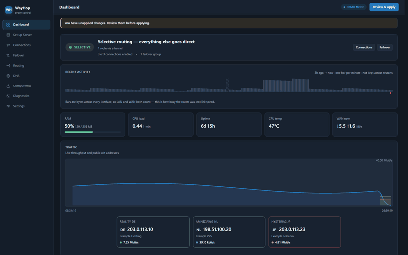
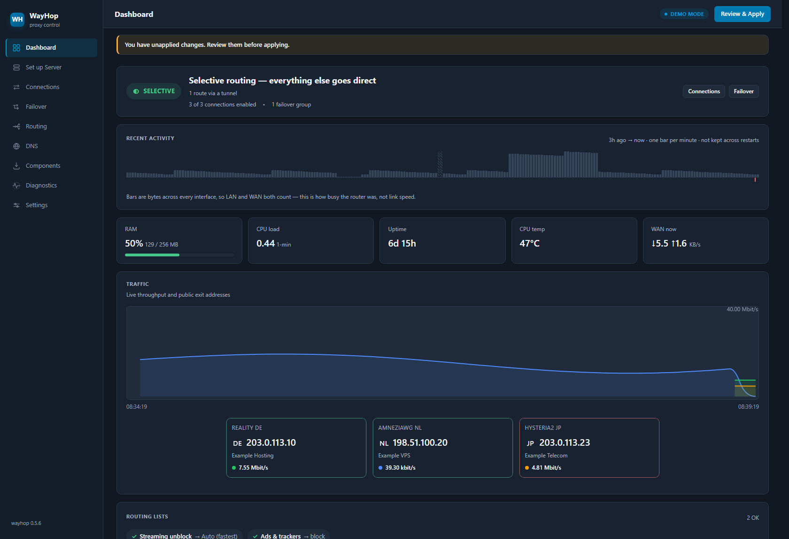
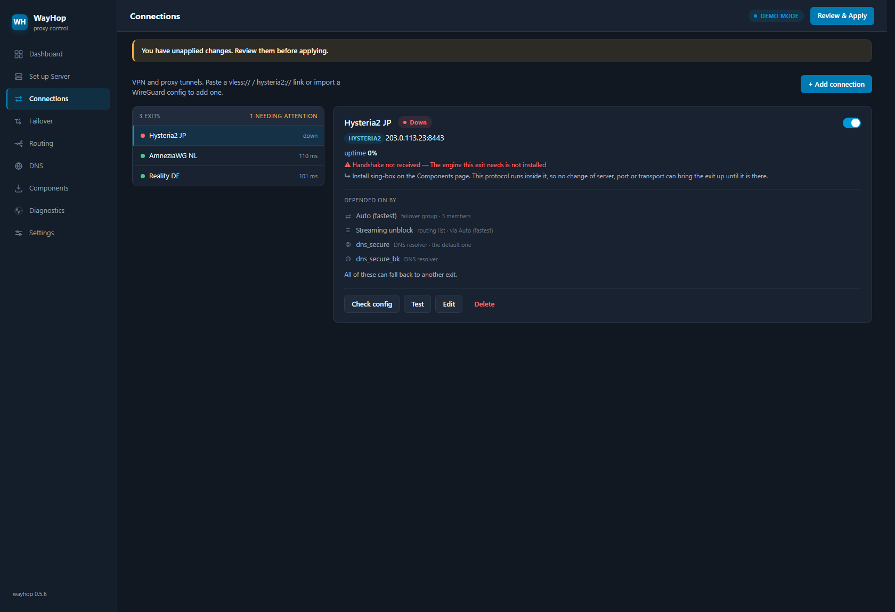
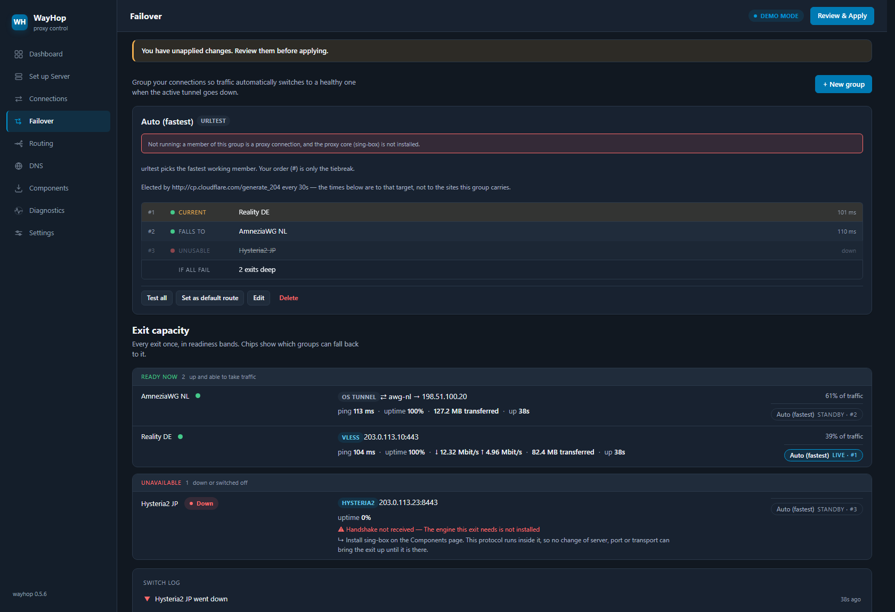
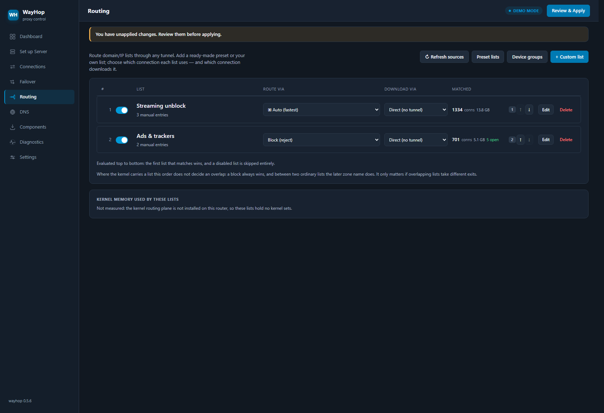
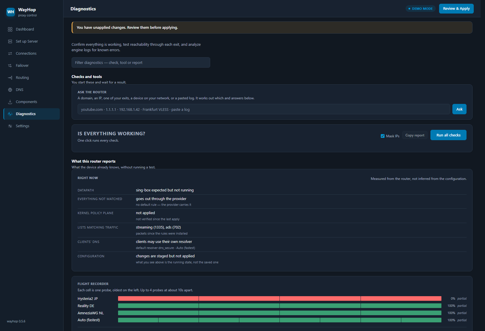

<div align="center">


**A router web panel for modern VPN and proxy protocols, with failover, selective routing and an Apply that undoes itself.**

[](LICENSE)
[](../../releases/latest)
[](go.mod)
[](#supported-platforms-and-cpus)
[](#supported-platforms-and-cpus)

</div>

<div align="center">

</div>

## What it is

WayHop is one static Go binary (the web UI is compiled into it) that runs as a service on your
router and drives [sing-box](https://github.com/SagerNet/sing-box) from a browser. You paste a share
link, a subscription URL or a `.conf`, pick what routes through it, and press Apply.

It listens on its own port (`:8088` by default) and writes its own config and its own kernel routing
rules. It does not edit your router's native VPN configuration, and it routes only the traffic it
marks itself, so it can sit next to whatever the firmware already does.

**Who it is for.** People already running OpenWrt, or Entware under `/opt` (which includes most
Keenetic routers on stock firmware), who are currently maintaining sing-box JSON, policy-routing
scripts and SSH sessions by hand.

**What it is not.** Not a VPN service: you bring your own servers. Not a firmware replacement. Not a
protocol implementation: it orchestrates cores other people maintain.

**How finished it is.** Pre-1.0, and versioned accordingly. The panel, the routing planes and the
apply/rollback path are in daily use on OpenWrt and Keenetic hardware, and every release runs a
gate suite that fails the build on a regression. What pre-1.0 means in practice: the saved
configuration format can still gain fields between releases (they are migrated, not dropped), and a
setting can be renamed where its old name was misleading. Upgrades keep your configuration; the
installer takes a backup before it swaps the binary.

<div align="center">

</div>

<details align="center">
<summary><b>More screenshots</b></summary>

| Connections | Failover |
|:---:|:---:|
|  |  |
| **Routing** | **Diagnostics** |
|  |  |

</details>

## What makes it different

- **Apply is reversible by default.** A plain Apply is live until reboot; nothing is committed to
  flash until you Save. If the router loses internet after an Apply, WayHop restores the previous
  config on its own (default: after ~45 s of failed connectivity checks). A guarded auto-reboot as a
  last resort exists but is off unless you turn it on.

- **Kernel routing where the kernel can do it.** Routing rules are compiled into a policy-routing
  plan (an `nftables` table on OpenWrt, `ipset` + `iptables` mangle marks on KeeneticOS) under
  WayHop's own table name and its own fwmark. In `fast` mode general LAN traffic never enters
  userspace at all; only the destinations you carve out are steered.

- **The panel refuses what the box cannot do.** Every routing mode, matcher and protocol is
  evaluated against three separate questions: can this OS do it, is it wired into this build's apply
  path, and are the binaries and modules present right now. A mode whose answer is not a clear yes is
  rejected by the API, not just greyed out in the UI, so an Apply cannot report success over a
  datapath that would carry nothing.

- **It says when it cannot see something.** A diagnostic that had nothing to measure reports `n/a`
  rather than a green pass. A routing list carried entirely by the kernel is labelled
  *kernel-routed* instead of showing a misleading `0` byte counter.

- **No dependencies until you Apply.** The binary has no runtime dependencies; the UI, diagnostics,
  import and configuration all work before sing-box is installed. sing-box is needed to actually run
  a proxy config (a purely kernel-native WireGuard/AmneziaWG datapath does not need it).

## Protocols

| Protocol | Notes | Runs on |
|---|---|---|
| **VLESS** | Reality or TLS, uTLS fingerprints; TCP, WebSocket, gRPC, HTTP/2, HTTPUpgrade | sing-box |
| **VMess** | same transports | sing-box |
| **Trojan** | TLS, with the same transports | sing-box |
| **Shadowsocks** | AEAD and SS-2022 ciphers; `obfs-local` / `v2ray-plugin` passed through | sing-box |
| **Hysteria2** | QUIC, Salamander obfuscation, port hopping | sing-box |
| **TUIC v5** | QUIC, selectable congestion control, `native`/`quic` UDP relay | sing-box |
| **AnyTLS** | TLS with SNI and uTLS fingerprint options | sing-box |
| **WireGuard** | kernel interface where available, otherwise a sing-box endpoint | kernel / sing-box |
| **AmneziaWG** | WireGuard plus junk-packet obfuscation (1.x, 2.0 and 3.x parameters) | kernel / `amneziawg-go` |
| **olcRTC** | tunnel over a WebRTC conferencing service — **import and store only in this build**: the engine is installable from Components, but WayHop has no executor for it, so such a connection cannot be enabled | `olcrtc` |

Import from: `vless://`, `vmess://`, `trojan://`, `ss://`, `hysteria2://`, `hy2://`, `tuic://`,
`anytls://`, `wireguard://`; a WireGuard or AmneziaWG `.conf`; a Clash / Clash-Meta YAML; a sing-box
config; an olcRTC YAML; or a subscription URL. Subscriptions detect base64 vs. plain text, import
each link independently so one bad entry does not sink the batch, and de-duplicate by content — same protocol, server, port and credentials — never by display name.

The panel can also stand up a server for you: **Set up Server** generates and (over SSH) runs an
idempotent installer on a fresh Debian/Ubuntu VPS for AmneziaWG, WireGuard, VLESS-Reality, VMess,
Trojan, Shadowsocks, Hysteria2 or TUIC, then imports the client config it prints. Credentials are
not stored or logged.

## Supported platforms and CPUs

| | OpenWrt | Entware under `/opt` (incl. Keenetic) |
|---|:---:|:---:|
| Install, run as a service, self-update | yes | yes |
| Every protocol, failover, health, diagnostics | yes | yes |
| `mixed` and `tun` routing | yes | yes |
| Kernel policy routing (`fast` / `hybrid`) | needs `nftables` | needs `ipset` + `iptables` |
| Domain carve-outs in `fast` mode (no TUN) | not available | via `dnsmasq` ipsets |

Init systems: `procd` on OpenWrt (`/usr/sbin`, `/etc/wayhop`, `/etc/init.d`), busybox sysvinit on
Entware (`/opt/sbin`, `/opt/etc/wayhop`, `/opt/etc/init.d/S99wayhop`). Package managers: `opkg`
(OpenWrt up to 24.10, and Entware) or `apk` (OpenWrt 25.12+).

CPUs: `mipsle`, `mips` (big-endian), `arm` (ARMv7), `arm64`, `amd64`. MIPS builds are softfloat.
**ARMv6, ARMv5 and 32-bit x86 are refused**: the published `arm` build is ARMv7 and would crash on
an older core, and the installer stops rather than install it. A bare `arm` from `uname -m` is
ambiguous and is also refused; pass `--arch arm` if you know the CPU is ARMv7.

## Requirements

- **Root shell on the router** (SSH). The installer writes an init script and kernel routing rules;
  there is no unprivileged mode.
- **~20 MB free** on the filesystem WayHop installs into (`/opt` on Entware, the overlay on
  OpenWrt). The installer warns below that: an upgrade stages the new binary beside the old one, so
  a swap needs room for both. Installed size is about 12 MB; the download is about 5 MB. sing-box
  adds a few MB on top of that, which is why the OpenWrt installer only offers to install it when
  the overlay has at least 25 MB free.
- **Entware already set up** if you are on Keenetic or another stock firmware — WayHop installs into
  `/opt` and does not bootstrap Entware for you. On OpenWrt nothing extra is needed.
- **RAM**: it runs in the tens of megabytes at idle. It is reported by the installer rather than
  enforced, because the real ceiling is whatever core you run beside it — sing-box, not WayHop, is
  the memory-hungry half.
- `curl` or `wget`, and `sha256sum` or `openssl`, for the installer itself.

## Install

One command, over SSH on the router, as root:

```sh
curl -fsSL https://github.com/awadak3davra/wayhop/releases/latest/download/bootstrap.sh | sh
```

No `curl`? `wget` works the same way:

```sh
wget -qO- https://github.com/awadak3davra/wayhop/releases/latest/download/bootstrap.sh | sh
```

The bootstrap detects the CPU and the flavour (OpenWrt vs. Entware), resolves the latest stable
release, and downloads `SHA256SUMS.txt` **before** the tarball. It refuses to continue if the asset
is not listed exactly once or its digest is malformed, then verifies the downloaded tarball's
SHA-256 and refuses to install on a mismatch. Verification is never skipped. Where `usign` or
`signify` is installed (OpenWrt), it also verifies `SHA256SUMS.txt.sig` against a public key embedded
in the script. On those devices a missing or failing signature is fatal rather than a warning.
Elsewhere it warns that authenticity is not independently verified and enforces the SHA-256 over
GitHub HTTPS. Nothing to fill in: no version, arch or package name.

It needs `curl` or `wget`, and `sha256sum` or `openssl`. It stops with an explanation if either is
missing.

Options:

```sh
curl … | WAYHOP_VERSION=vX.Y.Z sh     # pin a release
curl … | WAYHOP_PRERELEASE=1 sh       # allow the newest pre-release
```

The environment variable goes **before `sh`**, not before `curl`: in front of `curl` it never
reaches the shell that runs the installer. For installer flags, download first and pass them after a
literal `--`:

```sh
curl -fsSLO https://github.com/awadak3davra/wayhop/releases/latest/download/bootstrap.sh
sh bootstrap.sh -- --port 8089
```

`--arch mipsle`, `--openwrt` and `--entware` on the bootstrap itself override auto-detection.

### What the installer does

It runs pre-flight checks (free flash, RAM, clock/NTP, internet reachability, and the `ip` / `ipset`
/ `iptables` routing dependencies), then scans for conflicts (whatever already listens on the UI
port, `keen-pbr`, a stray `sing-box`, a previous install) and offers to resolve each one. Piped from
`curl` there is no TTY, so every prompt takes its default. Two of those defaults are yes, because
they are the install rather than a change to the router's own setup: the missing routing packages,
and sing-box. The rest stay conservative - it moves WayHop to a free port (8089, 8090, 8091, 8099
or 18088) rather than disturbing whatever holds `:8088`, and it never disables a foreign service. It then installs the binary with an atomic swap and a single rolling
backup, installs the init script and a default config, starts the service and health-checks the UI.

It finishes with something like:

```
  == Done ==
  + version:  wayhop 0.5.x (abc1234, 2026-07-25T00:00:00Z)
  + UI is up (HTTP 200 on :8088)
  open  ->  http://198.51.100.1:8088
```

The exit code reflects the real outcome: a UI that did not come up exits non-zero.

## After install

1. **Open the URL it printed.** The first screen is *Secure this WayHop panel*, and until you
   answer it the panel is closed: every API call returns `operator setup is required` and nothing on
   the router can be changed. A panel holding every tunnel's private key does not open itself just
   because nobody has answered yet. There are two ways to answer:

   - **Create an operator account** — the ordinary choice. There is no default password; passwords
     are at least 12 characters and are stored only as an Argon2id hash.
   - **Choose to run with no password** — available deliberately, for a panel already behind
     something else. It takes two explicit clicks, the form states what it opens up, and the choice
     is recorded and reversible in Settings → Account. A stored password always wins: once an
     account exists, this flag is ignored.

2. **sing-box** is what carries the proxy protocols, and the installer already offered to install
   it - piped from `curl` it installs it without asking, except on an OpenWrt overlay too small to
   hold it. If you declined or the router had no package for it, add it later with `opkg install
   sing-box`, or from the **Components** page, which can install and update sing-box,
   `amneziawg-go` and `olcrtc` on the router. WayHop detects the core and enables Apply. (WireGuard
   and AmneziaWG route natively in the kernel and need none of this, except an AmneziaWG 3
   connection the router's own AmneziaWG cannot carry: that one runs on `amneziawg-go`.)

3. **Add a connection**: paste a link, a subscription URL, a `.conf` or a Clash config.

4. **Create a failover group and press Apply.** Groups come in three kinds: `urltest` (automatically
   selects the lowest-latency working member), `selector` (you choose), and `fallback`. In this
   build `fallback` is generated as a `urltest` too — it picks the lowest-latency working member and
   uses your order only as a tiebreak; strict-order preference is not wired yet, and the panel says
   so on the group's card rather than implying an order it does not keep. A group can carry a
   kill-switch that drops its traffic when every member is down.

5. Apply is live until reboot. **Save** commits it. If connectivity drops in between, the previous
   config comes back on its own.

The panel is in English plus nine translations (Russian, Ukrainian, Belarusian, Persian, Turkish,
Spanish, French, German, Portuguese); only the selected language is sent to the browser, and Persian
renders right-to-left.

## Update

Re-run the same one command. On an upgrade the installer keeps your existing config and UI port,
backs up the current binary, swaps the new one in atomically and health-checks it. If the new
version does not come up, it restores the previous binary, restarts it and exits non-zero; the old
version keeps running. Only WayHop's own service is stopped; a foreign `sing-box` is never touched.

The **Components** page can also update WayHop itself from the panel, with an optional automatic
check. Installs from the package feed can use `opkg upgrade wayhop` (or `apk add -u wayhop` on
OpenWrt 25.12+) instead.

## Uninstall

The installer saves the uninstaller next to your config and prints the path at the end:

```sh
sh /opt/etc/wayhop/uninstall.sh     # OpenWrt: sh /etc/wayhop/uninstall.sh
```

It stops only WayHop and removes only WayHop's own paths: the binary, its rolling backup, the init
script, its `nft` table and its own fwmark `ip` rules (both IPv4 and IPv6). Shared dependencies
(`ip`, `ipset`, `iptables`, `sing-box`) are never removed, and a foreign table or rule is never
touched. Config and saved connections are **kept** by default; `--purge` deletes them too. It reports
what it kept.

### Offline or manual install

On a machine with internet, take two files for your arch from the
[Releases](../../releases/latest) page (`wayhop-<ver>-<arch>[-openwrt].tar.gz` and
`SHA256SUMS.txt`), copy both to the router, then verify and install:

```sh
grep " $(ls wayhop-*.tar.gz)$" SHA256SUMS.txt | sha256sum -c -    # must print OK
mkdir -p wr && tar -xzf wayhop-*.tar.gz -C wr && cd wr && sh ./install.sh
```

`SHA256SUMS.txt` also lists the `.ipk` and `.apk` packages, so check the one file you downloaded
rather than the whole manifest.

| `uname -m` | Arch | Entware / Keenetic | OpenWrt |
|---|---|---|---|
| `mips` (little-endian) | `mipsle` | `wayhop-<ver>-mipsle.tar.gz` | `…-mipsle-openwrt.tar.gz` |
| `mips` (big-endian) | `mips` | `wayhop-<ver>-mips.tar.gz` | `…-mips-openwrt.tar.gz` |
| `armv7l` | `arm` | `wayhop-<ver>-arm.tar.gz` | `…-arm-openwrt.tar.gz` |
| `aarch64` | `arm64` | `wayhop-<ver>-arm64.tar.gz` | `…-arm64-openwrt.tar.gz` |
| `x86_64` | `amd64` | `wayhop-<ver>-amd64.tar.gz` | `…-amd64-openwrt.tar.gz` |

MIPS routers report a bare `mips` either way; the bootstrap reads the endianness out of the busybox
ELF header to choose between the two builds. If you are picking the tarball by hand and are unsure,
`mipsle` is the common case (MT7621 and most Keenetic hardware).

There is also a signed package feed. See the
[feed page](https://awadak3davra.github.io/wayhop-feed/) for the key and repository line, then
`opkg install wayhop` or `apk add wayhop`. Every release additionally attaches the `.ipk` and `.apk`
packages directly for offline package installs.

## Routing

Lists match by domain, IP/CIDR, GeoSite/GeoIP, source IP, source port, source MAC or ingress
interface. MAC and ingress-interface matching exist only on the kernel plane; domain and geo
matching need the proxy core.

About thirty curated rule-set presets ship with the panel, drawn from public censorship-list and
service-IP feeds. Presets built on plain IP/CIDR or plain domain feeds need no proxy core at all;
compiled `.srs` rule-sets do. IP carve-outs can refresh themselves from an HTTPS prefix feed or from
RIPEstat announced-prefixes for a list of ASNs.

Four routing modes trade throughput against how finely traffic can be matched:

| Mode | General LAN traffic | Carve-outs | Requires |
|---|---|---|---|
| `mixed` *(default)* | not intercepted; only apps pointed at the local SOCKS/HTTP proxy | none | nothing |
| `tun` | all through the sing-box TUN | domain or IP | sing-box |
| `hybrid` | through the TUN | kernel IP/CIDR carve-outs, plus domains sniffed by the TUN | sing-box + kernel plane |
| `fast` | stays on the kernel fast path | kernel IP/CIDR carve-outs only | kernel plane |

`fast` has no capture-all TUN, which is exactly why it is fast and exactly what it costs: with no TUN
to read SNI, domain lists do not apply to general LAN traffic. On KeeneticOS domains still reach the
kernel plane through `dnsmasq` ipsets, where `dnsmasq` is present. The mode is picked in Settings and
takes effect on the next Apply; a mode the router cannot realise is refused rather than stored.

A list can also be scoped to named device groups, so a rule applies to some LAN devices and not
others. Per-device scope, source MAC and ingress-interface matching are kernel-plane features and are
unavailable where that plane is not usable.

## DNS

The DNS page sets the resolver chain, with DoH, DoT, DoQ and DoH3 upstreams, optional fake-IP, and a
leak-protection mode that requires encrypted upstreams and refuses to leave a plaintext local
resolver as the final answer. It draws the query path so you can see which resolver answers what and
whether it is encrypted, and it states the limit plainly: a client running its own DoH or DoT
resolver bypasses every row above it, and nothing here blocks that. Encrypted DNS and fake-IP need
the proxy core.

## Failover, health and diagnostics

Failover groups are built on sing-box `urltest` and watched by a supervisor that starts the core and
restarts it after a crash with exponential backoff. Health tracking records latency, success rate and
switch history per exit, and the failover view reads top to bottom as *expected → falls to → then →
if all fail*.

Diagnostics runs a battery on the router itself: ping, traceroute, DNS resolution and leak checks,
IPv6 leak (the tunnels are IPv4-only, so working global IPv6 can bypass them silently), clock skew
read from a remote HTTP `Date` header (NTP is often blocked), endpoint reachability, kernel-plane and
offload state, and config validation via `sing-box check`. A check that could not measure anything
reports `n/a` and is not counted as a pass. There is also a redacted support bundle and a Prometheus
scrape at `GET /metrics`.

## Telegram bot

A bot you create yourself answers from your phone: the router's status, its exits and failover log,
alerts as they happen, and a few controls. The router long-polls the Bot API, so nothing listens for
Telegram and no port is opened. Where Telegram is blocked, the bot's own API traffic can leave
through one of your tunnels, or go to a Bot API server you host.

Set it up in **Settings → Telegram bot**:

1. Create a bot with [@BotFather](https://t.me/BotFather) and paste its token. The token is
   write-only: the panel never shows it again, and it is not sent to a different Bot API server
   unless you type it again.
2. Pair each chat with a one-time code, or its QR code, as **owner**, **viewer** or **alerts only**.
   A group can be a viewer or an alert channel, never an owner. Anyone else who writes to the bot
   is refused, at most once every ten minutes, and listed in the panel for a day (in memory, the
   last twenty), where you can let them in.

**What it answers.** `/status` (which also names a routing list whose feed keeps failing: such a
list has only what it last got, or nothing if it never loaded), `/exits` (each exit's card has
*Test now*), `/events`, `/summary` of the last 24 hours, `/route youtube.com` (the rule and the exit
a site takes, and the live connections to it), `/devices` (who is on the network and who is using
the line right now), `/diag`, `/ping` and `/dns`. It speaks English, Russian and Ukrainian, chosen
per chat.

**Alerts.** An exit going down and coming back (the recovery replies to the outage), a group
switching exits, no internet on the uplink, a sing-box crash, a test Apply waiting for Keep or Roll
back, the router back after an outage, memory running low, a WayHop update. A burst of failures
arrives as one message; quiet hours hold what can wait and sum it up afterwards; `/mute` silences a
chat for an hour, critical alerts excepted; each chat switches the kinds it wants in `/alerts`. A
daily summary at a time you choose is optional.

**Owners** can also keep or roll back a test Apply from the chat while its countdown runs, apply
the saved changes as a test, refresh routing lists and the subscription, receive a backup file,
restart WayHop and install an update. Applying, restarting, updating and sending a backup ask
first, with a button that expires; a refresh only stages new content until the next Apply.

`/speed` measures the provider's line against the route the test's site takes through WayHop, or
against one WireGuard or AmneziaWG tunnel from its card, bound to that tunnel so nobody's traffic is
moved. Where the test's site would go straight out, by a rule of its own or because sites with no
rule go straight out, it says which instead of measuring the line twice. A line leg whose own
connections left by a tunnel is reported as that tunnel, and a path that does not answer reads "no
answer" after 8 seconds.

## Access and security

**WayHop is a LAN admin panel served over plain HTTP.** It has no TLS of its own.

> [!IMPORTANT]
> Do not expose the panel to the internet. Reach the router over a VPN, or put it behind a reverse
> proxy that terminates TLS and authenticates. Over plain HTTP anyone carrying the traffic can read
> the password, and the API returns keys and credentials to its own UI for editing.

Within that boundary:

- **Operator account.** Every route except `/api/auth/status`, `/api/auth/setup`, `/api/auth/login`,
  `GET /api/health` and the static assets requires a session. Sessions expire after 30 minutes idle
  or 12 hours absolute; the cookie is `HttpOnly` and `SameSite=Strict`; mutating requests must also
  carry the session's CSRF token as a header. Five failed logins from one address within ten minutes
  lock that address out for five minutes. Passwords are hashed with Argon2id (16 MiB, 2 passes).
- **Host allow-list, on by default.** A request must carry a `Host` this machine actually answers to:
  one of its interface addresses, loopback, or its hostname. `allowed_hosts` adds entries rather
  than replacing that base, so a mistaken list cannot lock you out. This is the DNS-rebinding defence
  a same-origin check cannot provide.
- **SSRF guard.** Subscription fetches and the TLS probe refuse to dial loopback, private, CGNAT and
  link-local addresses (including `169.254.169.254`), and decode NAT64 / 6to4 embedded IPv4 so a
  hostname cannot smuggle an internal target past the check.
- **Security headers.** `Content-Security-Policy: script-src 'self'; frame-ancestors 'none';
  base-uri 'none'; object-src 'none'`, plus `X-Frame-Options: DENY`, `X-Content-Type-Options:
  nosniff` and `Referrer-Policy: no-referrer`.
- **Resource caps.** Request bodies are capped at 16 MiB with a two-minute read deadline, and the
  daemon sets a heap soft limit from the router's RAM so a bulk import cannot get it OOM-killed.

A `--dev-no-auth` flag exists for development. It is a process flag only (nothing in `config.json`
can set it, so a reboot always comes back authenticated), and the daemon logs a `SECURITY:` line on
every start that uses it. Do not run a router with it.

## Limitations

- No TLS on the panel, and no built-in remote access to it; the [Telegram bot](#telegram-bot) covers
  status, alerts and a few controls from outside.
- `fast` mode cannot apply domain lists to general LAN traffic on OpenWrt; use `hybrid` or `tun` if
  you need them.
- `amneziawg-go` has no prebuilt upstream releases; WayHop's own releases carry a build for each
  router arch. Under sustained traffic it holds its packet buffers, measured at 60-120 MiB on a
  test stand, so on a router with little free memory prefer a kernel module that carries the config.
- ARMv6, ARMv5 and 32-bit x86 are not supported.
- Root is required: the installer writes to system directories and installs kernel routing rules.
- The plugin catalogue and the IPTV module are not part of this build.

## Build from source

Requires Go 1.22 or newer (CI builds with Go 1.26.5). The UI is embedded in the binary, so a UI
change needs a rebuild.

```powershell
./build.ps1            # Windows: cross-compile and package every arch into dist\
```
```sh
make package           # the same, on a Unix build host
```

One arch by hand:

```sh
CGO_ENABLED=0 GOOS=linux GOARCH=arm64 go build -trimpath \
  -ldflags "-s -w -X wayhop/internal/version.Version=0.5.7" \
  -o wayhop-arm64 ./cmd/wayhop
```

Run the panel locally with synthetic data and no sing-box. State goes to a throwaway temp
directory, and a loopback demo skips the login gate:

```sh
go run ./cmd/wayhop --demo --listen 127.0.0.1:8088
```

There are three one-shot CLI helpers for checking a parser without a router: `wayhop import <link>`
prints the parsed endpoint as JSON, `wayhop gen <link>` prints the sing-box config it would generate,
and `wayhop gen-profile <profile.json> [tun]` renders a whole saved profile so `sing-box check` can
validate it offline.

CI runs `go vet` and `go test -race`, checks the generated configs against two sing-box releases, and
cross-builds every router arch on each push. A `v*` tag additionally publishes a release with the
per-arch tarballs, the `.ipk` and `.apk` packages, `SHA256SUMS.txt` and its signature.

## Contributing and license

Issues and pull requests are welcome. The core is protocol-agnostic: adding a protocol touches
`model` → `importer` → `generator` → `exporter`, and validation stays generic.

**Reporting problems.** Bugs and questions belong in [issues](../../issues). For anything with a
security impact — a way past the login gate, a leak of traffic that should have gone through a
tunnel, anything touching the keys the panel stores — open a
[security advisory](../../security/advisories/new) instead of a public issue, so it can be fixed
before it is described.

Licensed under the [MIT License](LICENSE). Built on the MIT/Apache-licensed cores it orchestrates:
sing-box, amneziawg-go and olcRTC. See the [changelog](CHANGELOG.md) for release history.
